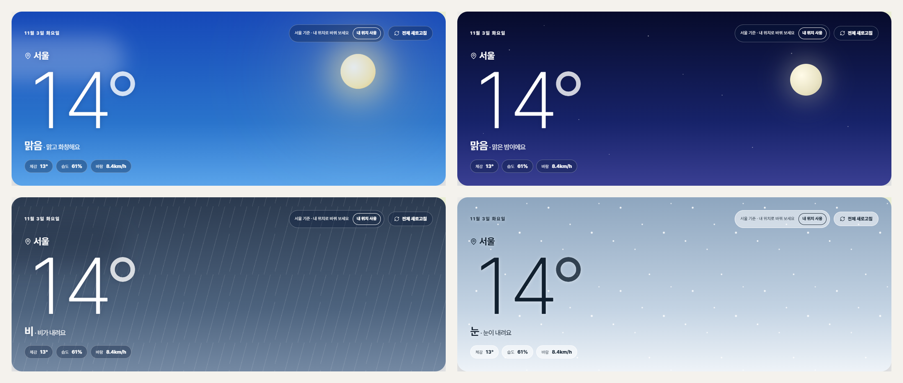
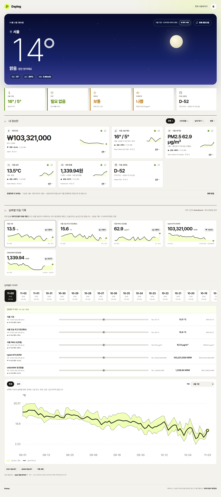
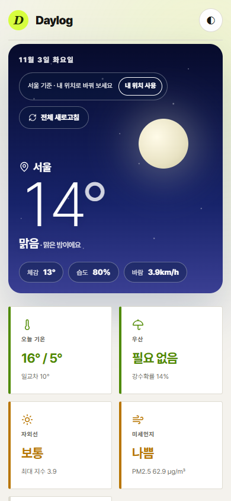
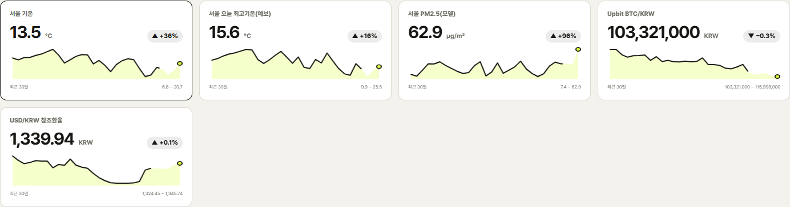
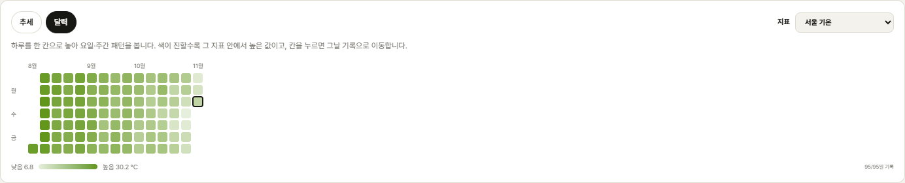
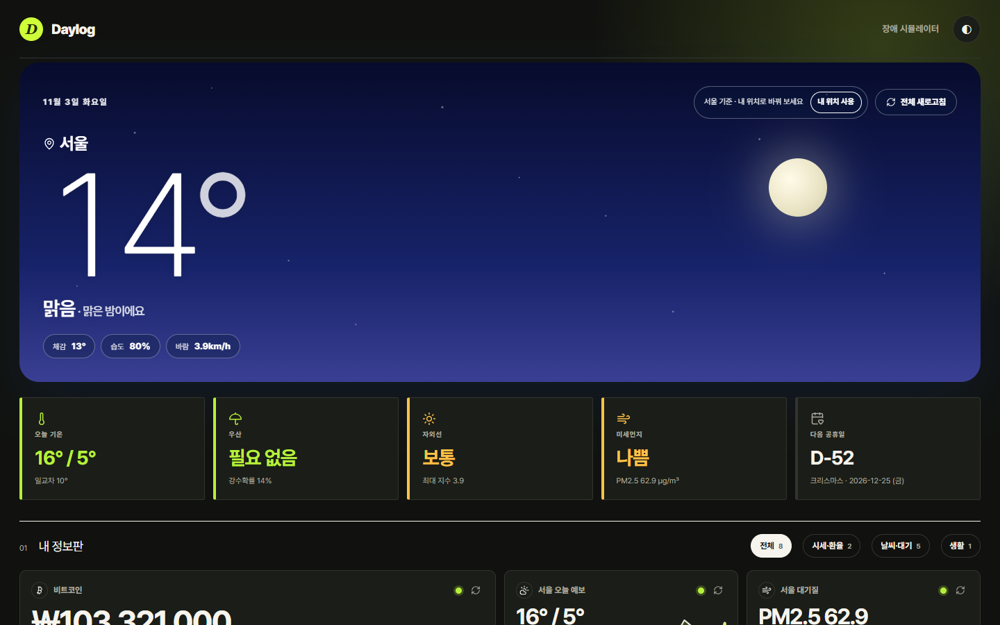
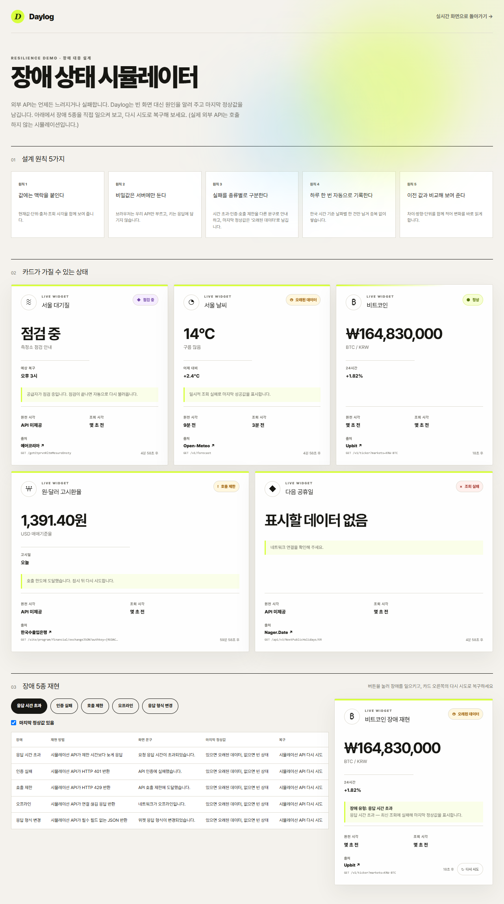
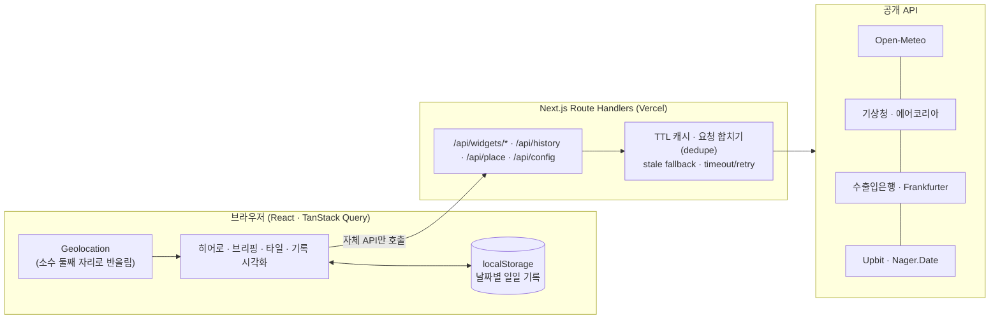

<div align="center">

# Daylog

**내 위치의 하늘이 곧 화면이 되는, 출처를 숨기지 않는 실시간 정보판**

날씨·미세먼지·환율·비트코인·공휴일을 한곳에 모으고, 매일의 값을 자동으로 기록해 추세로 보여 줍니다.

[**라이브 데모**](https://realtime-info-board-t04.vercel.app/) · [데이터 출처·개인정보](https://realtime-info-board-t04.vercel.app/about) · [장애 대응 데모](https://realtime-info-board-t04.vercel.app/verification)

    



</div>

## 한눈에

| | |
|---|---|
| **문제** | 대시보드는 값만 보여 줘서, 그 값이 *어디서* *언제* 왔는지, 지금 *믿어도 되는지* 알 수 없다. 장애가 나면 빈 화면이 된다. |
| **해결** | 모든 값에 **출처·원천 시각·조회 시각·상태**를 붙이고, 장애는 5가지로 나눠 마지막 정상값을 유지한 채 알린다. 값은 하루 한 줄씩 **자동 기록**해 추세로 보여 준다. |
| **내가 한 일** | 기획부터 설계·구현·테스트·성능/접근성 최적화·배포까지 전 과정 (AI 코딩 에이전트와 협업하며 의사결정과 검증은 직접 수행) |
| **결과** | Lighthouse **성능 98 / 접근성 100 / 모범 사례 100 / SEO 100**, axe-core 위반 0, 단위 108 + E2E 24 테스트 |

## 핵심 기능

- **내 위치 기반 하늘 히어로** — 브라우저 위치로 현재 날씨를 받아 낮/밤·맑음·구름·비·눈·안개·뇌우에 맞는 장면으로 바뀝니다. 데이터 층은 반투명 유리 패널 위에 두어 어떤 배경에서도 읽히게 했고(WCAG 대비 계산으로 검증), 모션 줄이기 설정을 따릅니다.
- **신뢰를 설계한 카드** — 카드마다 공급자·원천 시각·조회 시각·상태가 보입니다. 정상은 점 하나로 줄이고, 오래된 값·점검·호출 제한·오류만 눈에 띄게 올립니다. 상세는 "상세"를 눌러야 펼쳐집니다(점진적 공개).
- **8월 1일부터 자동 기록** — 접속하지 않은 날도 공급자의 과거 원자료(기온·PM2.5·환율·BTC 일봉)로 채우고, 오늘부터는 실시간으로 하루 한 줄씩 저장합니다. 같은 날짜는 항상 한 건이라 중복되지 않습니다.
- **한눈에 읽히는 시각화** — 지표별 요약 카드(현재값·어제 대비·30일 추세) → 달력 히트맵 → 최소~최대 밴드 추세 차트. 3D는 조사 후 의도적으로 **쓰지 않았습니다**(아래 설계 판단).
- **한국 일상에서 쓰는 데이터만** — Open-Meteo, 기상청, 에어코리아, 한국수출입은행, Upbit, 공휴일. 키가 필요한 공식 데이터는 키가 없으면 오류 카드 대신 안내로 대체됩니다.

<table>
<tr>
<td></td>
<td width="30%"></td>
</tr>
</table>

<table>
<tr>
<td></td>
<td></td>
</tr>
<tr>
<td colspan="2"></td>
</tr>
<tr>
<td colspan="2"></td>
</tr>
</table>

## 아키텍처



- 브라우저는 **외부 API를 직접 호출하지 않습니다.** 키 보호, CORS·http 혼합 콘텐츠 회피, 캐시 공유를 위해 모든 요청이 자체 Route Handler를 거칩니다(E2E로 보장).
- 모든 공급자는 하나의 계약 `WidgetData<T>`(값·출처·원천/조회 시각·상태·오류 종류)로 정규화됩니다.

## 설계 판단 (트레이드오프)

| 결정 | 이유 · 근거 |
|---|---|
| **3D 시각화를 넣었다가 제거** | 3D 막대 차트는 가림·원근 왜곡·정밀도 저하가 문제라는 조사 결과와, "한눈에 안 들어온다"는 사용자 피드백을 받아 달력 히트맵·작은 다중 차트(small multiples)로 교체. 3D는 전 지구 데이터처럼 공간 자체가 3차원일 때만 정당하다고 판단했고, 한국 일상 데이터엔 해당하지 않아 `three.js`(≈590KB)도 함께 제거. |
| **기록을 서버 DB가 아닌 localStorage에** | 개인 기록을 서버로 보내지 않는 것이 프라이버시 원칙. 대신 기기 간 공유가 안 되는 한계를 `/about`에 명시. 공유가 필요해지면 Supabase 등으로 확장(로드맵). |
| **과거 값은 공급자 원자료로 "자동 채움"** | 접속하지 않은 날도 하루 한 줄이 생기고, 저장값이 원자료와 다르면 원자료로 자동 보정. 일부 출처가 실패해도 나머지로 응답하고 실패 사유를 응답에 남김. |
| **키 없는 환경에서도 동작** | 환율은 수출입은행 키가 없으면 키 없는 국제 참조환율로 대체(출처·성격 표기). 기상청·에어코리아는 서버가 키 보유 여부(`/api/config`, 값 비노출)만 알려 키가 없으면 요청 자체를 하지 않음 → 503·콘솔 오류 0. |
| **위치는 사용자 동작으로** | 로드 시 권한 창을 띄우지 않음(Lighthouse·UX 권장). 이미 허용됐거나 저장된 위치가 있을 때만 자동 사용, 거부·미지원 시 서울 기준으로 이유와 함께 표시. 좌표는 ≈1km로 반올림, 지역별로 기록 키를 분리해 서울/부산 기록이 섞이지 않음. |

### 성능 개선 사례 — TBT 2,130ms → 190ms
Lighthouse가 총 차단 시간(TBT) 2.1초를 지적했습니다. 원인은 과거 기록 658건을 채울 때 건마다 배열 검색 + 전체 정렬을 반복하던 **O(n²)** 로직이었습니다. id → 항목 `Map`으로 한 번만 훑고 정렬·정리는 마지막에 한 번만 하도록 바꿔 **O(n log n)** 으로 만들고, 3,000건이 250ms 안에 끝나는지 단위 테스트로 고정했습니다. 함께 레이아웃 이동(CLS 0.09 → 0.01)과 로드 시 위치 권한 요청을 개선해 **성능 점수 69 → 98**.

## 품질 보증

| 영역 | 내용 |
|---|---|
| 단위 테스트 (108) | 공급자 어댑터, 캐시·재시도·stale fallback, 일일 기록 병합·중복 방지·성능, 위치 파싱·기상청 격자 변환, 하늘 장면 결정, 달력 배치 |
| E2E (24, Playwright) | 자체 API만 호출·키 비노출, 위치 기반 날씨, 날짜별 자동 기록·과거 채움, 제거된 API 404, 키 유무별 동작, 보안 헤더, 모바일 가로 스크롤 없음 |
| 접근성 | axe-core(WCAG 2.1 A/AA) 라이트·다크 **위반 0**, 키보드 조작·건너뛰기 링크·포커스 표시, 색에만 의존하지 않는 상태 표시(아이콘+문구) |
| 성능·SEO | Lighthouse(모바일 에뮬레이션, 프로덕션 빌드) 성능 98 · 접근성 100 · 모범 사례 100 · SEO 100, TBT 140ms, CLS 0.01 |
| 보안 | HSTS·X-Frame-Options·Referrer-Policy·Permissions-Policy 등, API 키는 서버 환경변수로만 사용 |

외부 API 장애를 먼저 설계했습니다. 장애 5종(시간 초과·인증 실패·호출 제한·오프라인·응답 형식 변경)은 [장애 대응 데모](https://realtime-info-board-t04.vercel.app/verification)에서 직접 재현·복구해 볼 수 있습니다.

## 실행

```bash
npm ci
cp .env.example .env.local   # 키는 선택 사항 — 없어도 날씨·비트코인·공휴일·환율은 동작
npm run dev                  # http://localhost:3000
```

```bash
npm run lint && npm run typecheck && npm test   # 정적 검사 + 단위 테스트
npm run build && npm run test:e2e               # 프로덕션 빌드 + E2E (Chrome 필요)
PORTFOLIO_SHOTS=1 npx playwright test portfolio-shots   # README 스크린샷 재생성
```

| 환경변수 (서버 전용) | 효과 |
|---|---|
| `DATA_GO_KR_SERVICE_KEY` | 공공데이터포털 키 → 기상청 실황 · 에어코리아 시·도 평균 활성화 |
| `EXIM_SERVICE_KEY` | 한국수출입은행 키 → 환율이 국제 참조환율에서 한국 고시환율로 전환 |

## 데이터 출처와 이용 조건

Open-Meteo(CC BY 4.0), 기상청·에어코리아·수출입은행(공공데이터포털), Upbit, Frankfurter(ECB 참조환율), Nager.Date, BigDataCloud. 자세한 조건과 개인정보 처리 방식은 [/about](https://realtime-info-board-t04.vercel.app/about)에 있습니다.

> ⚠️ **상업 운영 시 주의**: Open-Meteo 무료 API는 **비상업적 이용 한정**입니다. 상업 서비스로 운영하려면 상업용 구독 또는 대체 공급자가 필요합니다. 각 공급자의 약관은 변경될 수 있어 공개 전 최신 조건을 확인해야 합니다.

## 프로젝트 구조

```
src/
  app/                 라우트: 정보판 · /about · /verification · /api/*
  components/          히어로(sky-hero) · 타일 · 브리핑 · 기록 패널 · 달력 · 차트
  lib/
    providers/         공급자 어댑터(WidgetData<T>로 정규화) · history(과거 채움)
    server/            캐시·dedupe·timeout/retry·응답 변환
    history/           일일 기록(병합·중복 방지·보관) · 기간 계산
    sky.ts · location.ts  하늘 장면 결정 · 위치 파싱/기상청 격자 변환
tests/e2e/             Playwright (접근성·위치·기록·보안 헤더 …)
docs/                  설계·배포·트러블슈팅·과제 제출 자료(T04)
```

## 로드맵

- 기기 간 기록 공유(Supabase) · 기상특보·서울 지하철/따릉이 추가 · 위젯 개인화(순서·표시) · PWA 오프라인 캐시

## 문서

과제(T04) 제출 자료와 개발 과정 기록은 `docs/`에 보존되어 있습니다: [T04 README 원본](docs/T04_과제_README.md) · [작업내역](작업내역_체크리스트.md) · [배포](docs/05_배포.md) · [트러블슈팅](docs/트러블슈팅.md)
